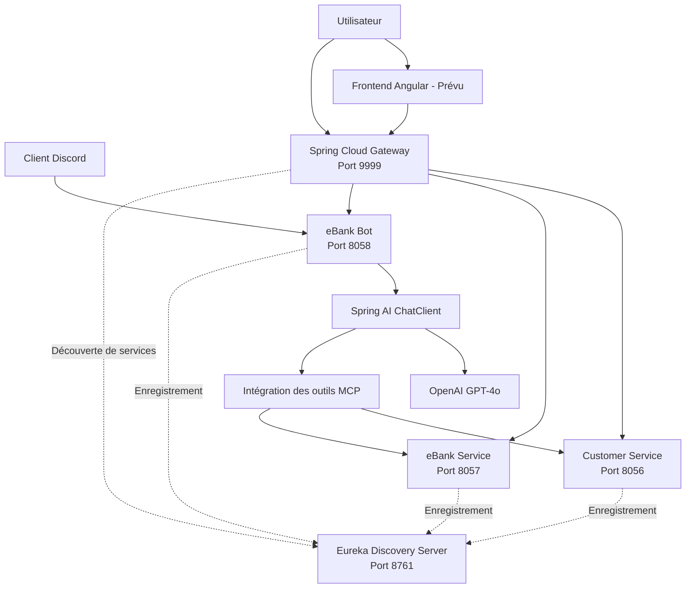
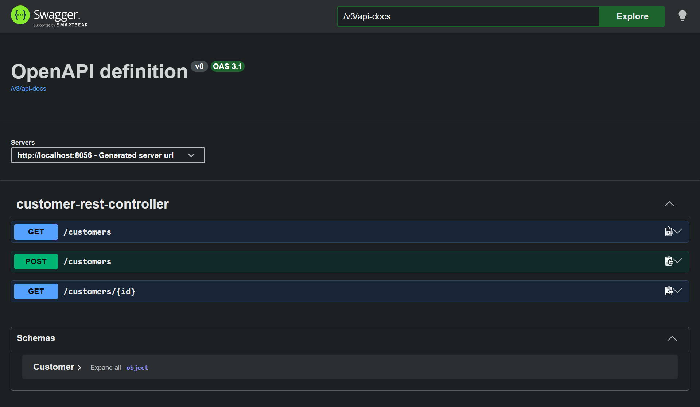
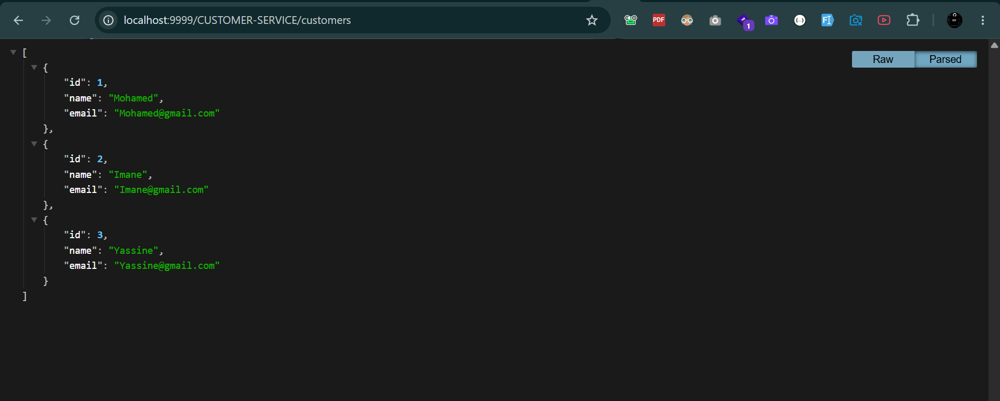
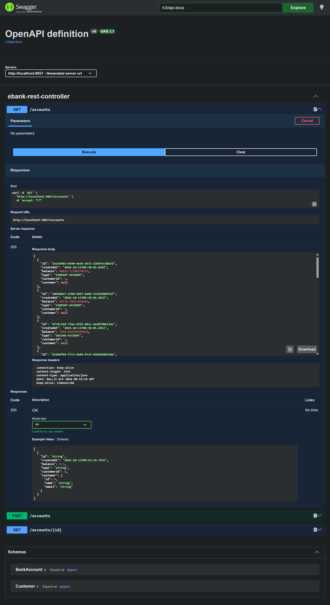
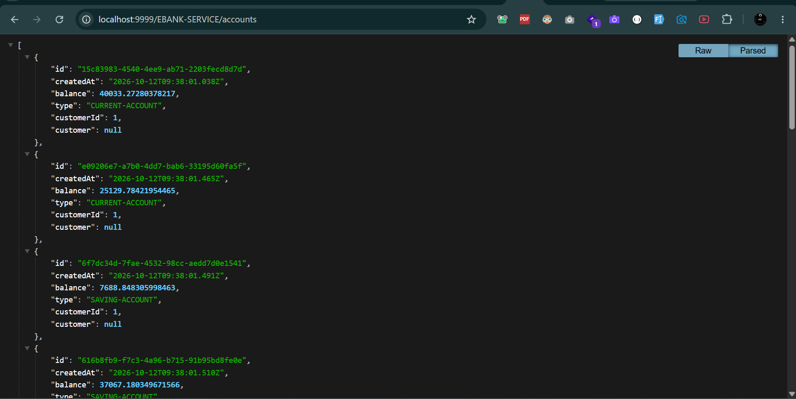
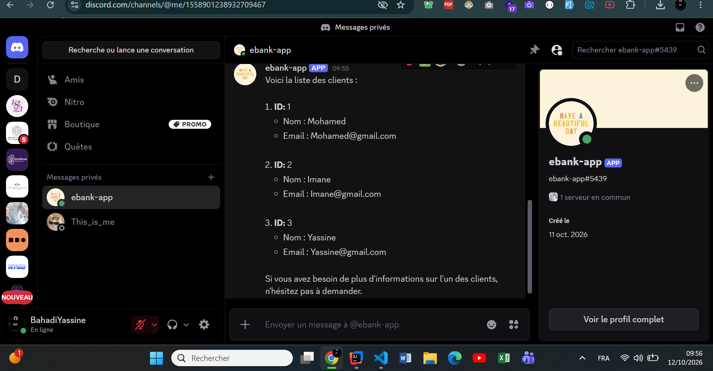
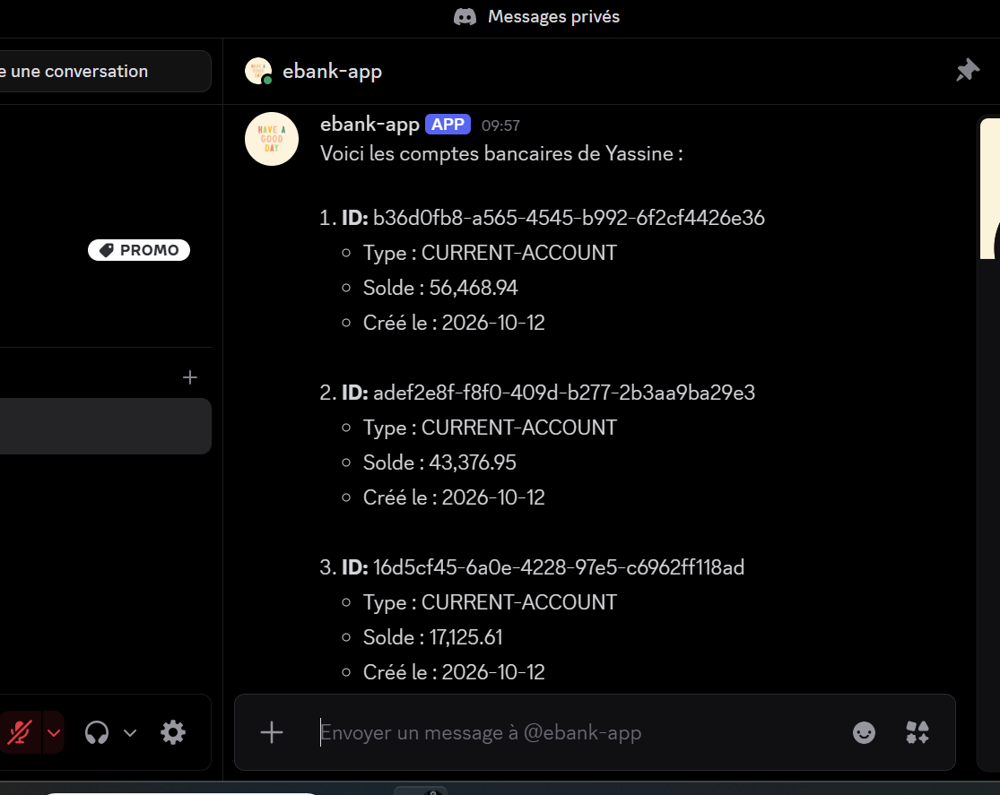
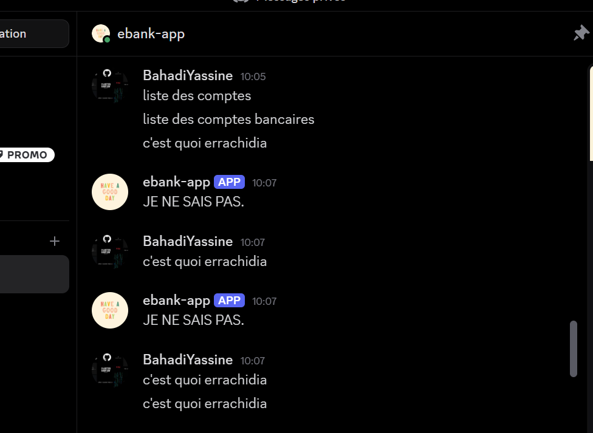
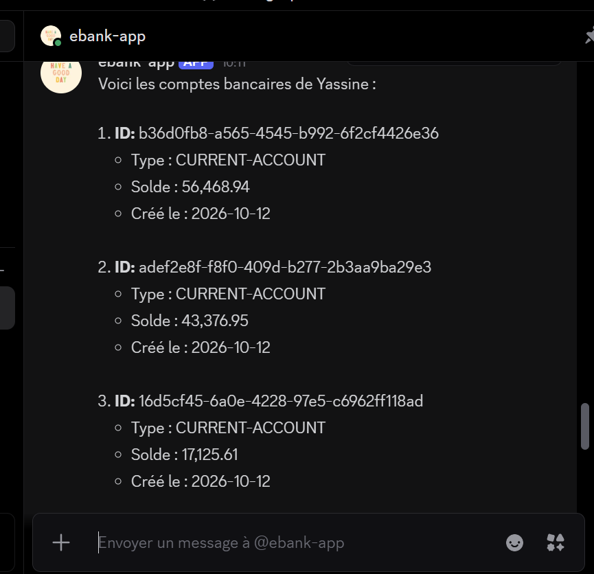

# eBank Bot — Microservices bancaires & assistant IA

## 1. Présentation

**eBank Bot** est une application bancaire construite sur une **architecture microservices** et dotée d'un **assistant conversationnel basé sur l'IA**.

Le backend est composé de services Spring Boot indépendants, responsables de la gestion des clients, de la gestion des comptes bancaires, de la découverte de services, du routage des API et des interactions assistées par l'IA.

L'assistant utilise **Spring AI** et **OpenAI** pour traiter des questions en langage naturel. Grâce au **Model Context Protocol (MCP)**, il peut interagir avec les services clients et bancaires pour consulter des informations et exécuter certaines opérations.

L'assistant est également intégré à **Discord**, ce qui permet de dialoguer avec le chatbot directement depuis un serveur ou en message privé.

> Le projet est développé de manière incrémentale. Le backend et les intégrations du chatbot sont implémentés et testés ; le frontend Angular constitue la prochaine étape.

---

## 2. Objectifs du projet

- Mettre en place un backend modulaire avec des microservices Spring Boot.
- Séparer la gestion des clients et celle des comptes bancaires dans des services indépendants.
- Activer la découverte de services avec Netflix Eureka.
- Centraliser l'accès aux services avec Spring Cloud Gateway.
- Implémenter la communication inter-services avec OpenFeign.
- Améliorer la résilience grâce à des mécanismes de circuit breaker.
- Intégrer un assistant IA avec Spring AI et OpenAI.
- Exposer les capacités métier à l'assistant via des outils MCP.
- Conserver l'historique des conversations avec la mémoire de chat de Spring AI.
- Fournir un accès au chatbot via REST et Discord.
- Préparer le backend à l'intégration d'un frontend Angular.

---

## 3. Architecture

Chaque service a une responsabilité précise.



> Le frontend Angular est prévu. Les routes exactes de la Gateway dépendent des mappings configurés.

### Composants principaux

| Composant | Port | Responsabilité |
|---|---|---|
| Customer Service | 8056 | Opérations métier liées aux clients |
| eBank Service | 8057 | Opérations métier liées aux comptes bancaires |
| eBank Bot | 8058 | Assistant IA, endpoint de chat et intégrations chatbot |
| Eureka Discovery Server | 8761 | Enregistrement et découverte des services |
| Spring Cloud Gateway | 9999 | Point d'entrée centralisé des API |
| Frontend Angular | À définir | Interface utilisateur — prévu |

---

## 4. Stack technique

### Backend
- **Java** — langage principal.
- **Spring Boot** — développement applicatif et injection de dépendances.
- **Spring Web** — endpoints HTTP et REST.
- **Spring Data JPA** — persistance, là où elle est configurée.
- **Spring Cloud Netflix Eureka** — découverte de services.
- **Spring Cloud Gateway** — routage centralisé des requêtes.
- **Spring Cloud OpenFeign** — communication HTTP déclarative entre services.
- **Circuit Breaker** — résilience des appels inter-services.

### IA et chatbot
- **Spring AI** — intégration avec les modèles de langage.
- **OpenAI GPT-4o** — modèle utilisé par l'assistant.
- **Model Context Protocol (MCP)** — expose les opérations métier comme outils accessibles à l'IA.
- **Spring AI ChatMemory** — gestion de l'historique des conversations.
- **Discord** — interaction avec le chatbot via un bot Discord.
- **Telegram** — intégration disponible lorsque la configuration du bot correspondant est activée.

### Outils de développement
- **Maven** — gestion des dépendances et build.
- **Git** — gestion de versions.
- **IntelliJ IDEA** — environnement de développement.

---

## 5. Les microservices

### 5.1 Customer Service

**Port : 8056**

Ce service gère les opérations métier liées aux clients. Ses outils MCP sont :

| Outil | Description |
|---|---|
| `getAllCustomers` | Récupère la liste des clients |
| `findCustomerById(Long)` | Récupère un client par son identifiant |
| `saveCustomer(Customer)` | Enregistre un client |

Endpoint MCP : `http://localhost:8056/mcp`

**API REST exposée** (documentation Swagger) :

| Méthode | Route | Description |
|---|---|---|
| GET | `/customers` | Liste des clients |
| POST | `/customers` | Création d'un client |
| GET | `/customers/{id}` | Détail d'un client |



*Documentation OpenAPI du Customer Service (port 8056).*

Accès via la Gateway : `http://localhost:9999/CUSTOMER-SERVICE/customers`



*Liste des clients retournée en JSON à travers Spring Cloud Gateway.*

### 5.2 eBank Service

**Port : 8057**

Ce service gère les comptes bancaires indépendamment du Customer Service. Ses outils MCP sont :

| Outil | Description |
|---|---|
| `getAllAccounts` | Récupère la liste des comptes bancaires |
| `findAccountById(Long)` | Récupère un compte par son identifiant |
| `saveAccount(Account)` | Enregistre un compte bancaire |

Endpoint MCP : `http://localhost:8057/mcp`

**API REST exposée** (documentation Swagger) :

| Méthode | Route | Description |
|---|---|---|
| GET | `/accounts` | Liste des comptes bancaires |
| POST | `/accounts` | Création d'un compte |
| GET | `/accounts/{id}` | Détail d'un compte |



*Documentation OpenAPI et test de `GET /accounts` sur l'eBank Service (port 8057).*

Accès via la Gateway : `http://localhost:9999/EBANK-SERVICE/accounts`



*Liste des comptes bancaires retournée en JSON à travers Spring Cloud Gateway.*

### 5.3 Eureka Discovery Server

**Port : 8761**

Eureka assure l'enregistrement et la découverte des services : au lieu de s'appuyer exclusivement sur des adresses codées en dur, les services enregistrés se découvrent via le registre.

Tableau de bord : `http://localhost:8761/`

### 5.4 Spring Cloud Gateway

**Port : 9999**

Point d'entrée centralisé pour les requêtes vers les services backend. Ses responsabilités :

- Router les requêtes vers le microservice approprié.
- Centraliser l'accès aux routes de services configurées.
- S'intégrer à l'architecture de découverte de services.

Les routes de la Gateway doivent correspondre aux définitions configurées dans l'application. Dans ce projet, les services sont accessibles via leur nom Eureka, par exemple `/CUSTOMER-SERVICE/**` et `/EBANK-SERVICE/**`.

### 5.5 eBank Bot

**Port : 8058**

Interface conversationnelle entre les utilisateurs, le modèle d'IA et les microservices bancaires. Ses responsabilités :

- Recevoir des questions en langage naturel.
- Envoyer les prompts au `ChatClient` de Spring AI.
- Utiliser un prompt système pour définir le rôle de l'assistant.
- Conserver l'historique via la mémoire de chat.
- Se connecter au Customer Service et à l'eBank Service via MCP.
- Retourner la réponse générée via HTTP.
- Traiter les messages reçus via Discord.

Connexions MCP :

```
Customer MCP : http://localhost:8056/mcp
eBank MCP    : http://localhost:8057/mcp
```

---

## 6. Assistant IA et intégration MCP

### 6.1 Spring AI ChatClient

Le chatbot utilise le `ChatClient` de Spring AI pour communiquer avec le modèle OpenAI configuré.

Le prompt système définit l'assistant comme un assistant bancaire centré sur les clients et les comptes bancaires, et lui demande de ne pas inventer d'informations lorsque le contexte nécessaire n'est pas disponible.

### 6.2 Model Context Protocol

MCP fournit un moyen standardisé pour une application d'IA d'accéder aux capacités exposées par d'autres services.

Le flux d'intégration est le suivant :

1. L'utilisateur envoie une question.
2. L'eBank Bot transmet le prompt au modèle d'IA.
3. L'assistant peut utiliser les outils MCP mis à disposition par l'application.
4. Le microservice concerné exécute l'opération métier demandée.
5. Le résultat de l'outil est renvoyé à l'assistant.
6. L'assistant formule une réponse pour l'utilisateur.

La capacité de l'assistant à exécuter une opération métier dépend des outils enregistrés auprès du `ChatClient` ainsi que des permissions et validations implémentées dans les services.

### 6.3 Mémoire de conversation

La mémoire de chat de Spring AI sert à conserver le contexte des conversations.

Chaque requête doit inclure un `conversationId` identifiant la conversation dont l'historique doit être récupéré. Réutiliser le même identifiant permet de conserver l'historique ; un identifiant différent sépare les historiques.

> Pour un déploiement multi-utilisateurs, les identifiants de conversation doivent être conçus pour éviter tout partage involontaire de contexte entre utilisateurs.

---

## 7. API HTTP

### Endpoint de chat

Le chatbot expose un endpoint `GET` pour tester les interactions conversationnelles.

```
GET /chat
```

**URL de base :** `http://localhost:8058`

**Paramètres de requête**

| Paramètre | Obligatoire | Description |
|---|---|---|
| `query` | Non | Question en langage naturel ; valeur par défaut : `Bonjour` |
| `conversationId` | Non | Identifiant de conversation ; valeur par défaut : `default` |

**Exemple de requête**

```
GET http://localhost:8058/chat?query=Bonjour&conversationId=test-1
```

**Exemple de question bancaire**

```
http://localhost:8058/chat?query=Quels%20sont%20les%20clients%20disponibles%3F&conversationId=test-1
```

L'endpoint retourne la réponse de l'assistant en **texte brut** (`text/plain`). Le contenu exact dépend du prompt, des outils MCP disponibles, des données retournées par les services et du modèle de langage.

### Exemples de résultats

**Liste des clients** — l'assistant interroge le Customer Service via MCP :



**Liste des comptes bancaires** — l'assistant interroge l'eBank Service via MCP :



**Question hors périmètre bancaire** — l'assistant répond également à des questions générales :



> ⚠️ L'identifiant par défaut (`default`) est pratique pour les tests en local. Une application en production doit fournir un identifiant adapté par utilisateur ou par session plutôt que de partager une conversation unique.

---

## 8. Intégration Discord

L'intégration Discord permet de communiquer avec l'assistant IA depuis un serveur Discord ou en message privé.

Le gestionnaire de messages suit ces étapes :

1. Il reçoit un événement de message Discord.
2. Il ignore les messages écrits par des bots.
3. Il extrait le texte du message.
4. Il utilise l'identifiant du canal Discord comme identifiant de conversation.
5. Il appelle l'agent IA eBank.
6. Il renvoie la réponse générée dans le canal Discord.



*Le bot `ebank-app` répond sur Discord avec la liste des clients.*

L'utilisation de l'identifiant du canal signifie que les messages d'un même canal partagent le même historique. Si une isolation par utilisateur est nécessaire, l'identifiant peut combiner l'ID du canal et celui de l'auteur.

**Configuration Discord**

- Le bot nécessite un token valide, configuré en dehors du code source.
- Le bot doit être invité sur le serveur avec les permissions et les *message intents* requis par l'implémentation.

---

## 9. Configuration

La configuration principale se trouve dans les fichiers `application.properties` ou `application.yml` de chaque microservice.

Configuration de l'eBank Bot :

```properties
spring.application.name=ebank-bot

server.port=8058

spring.ai.openai.api-key=${OPENAI_API_KEY}
spring.ai.openai.chat.model=gpt-4o

spring.cloud.discovery.enabled=true
spring.cloud.config.enabled=false

spring.ai.mcp.client.streamable-http.connections.customer.url=http://localhost:8056/mcp
spring.ai.mcp.client.streamable-http.connections.ebank.url=http://localhost:8057/mcp
```

Le token Discord doit également être fourni via une variable d'environnement et mappé sur la propriété de configuration utilisée par l'intégration Discord.

### Variables d'environnement

```bash
OPENAI_API_KEY=<votre-clé-api-openai>
DISCORD_TOKEN=<votre-token-bot-discord>
TELEGRAM_BOT_TOKEN=<votre-token-bot-telegram-si-activé>
```

Ces valeurs sont des exemples de noms de variables. Chaque propriété de l'application doit référencer la variable correspondante.

### Règles de sécurité

- Ne jamais committer de clés API ou de tokens de bot dans Git.
- Ne pas écrire d'identifiants directement dans le code Java.
- Garder les fichiers d'environnement locaux hors du contrôle de version.
- Révoquer et renouveler tout token accidentellement exposé.
- Mettre en place une authentification et une autorisation adaptées avant d'exposer des opérations bancaires en dehors d'un environnement de développement local.

---

## 10. Lancer le projet en local

### Prérequis

- Un JDK compatible avec le projet.
- Maven ou le Maven Wrapper inclus dans le dépôt.
- Un IDE, par exemple IntelliJ IDEA.
- Une clé API OpenAI valide.
- Des identifiants Discord et/ou Telegram si ces intégrations sont utilisées.
- Toute base de données requise par les services, configurée avant leur démarrage.

### Ordre de démarrage

1. **Eureka Discovery Server** — port 8761
2. **Customer Service** — port 8056
3. **eBank Service** — port 8057
4. **Spring Cloud Gateway** — port 9999
5. **eBank Bot** — port 8058

Cet ordre permet au registre de services et aux services métier de démarrer avant que le chatbot ne tente de s'y connecter.

### Build et exécution

Depuis le répertoire du projet Maven concerné :

```bash
mvn clean install
```

Pour lancer un service Spring Boot :

```bash
mvn spring-boot:run
```

Exécutez ces commandes depuis le répertoire de chaque service, ou adaptez-les à la structure Maven du dépôt.

### Vérifier les services

1. Ouvrir le tableau de bord Eureka : `http://localhost:8761/` et vérifier que les services attendus sont enregistrés.
2. Tester le chatbot : `http://localhost:8058/chat?query=Bonjour&conversationId=test-1`
3. Envoyer un second message avec le même `conversationId` pour vérifier la continuité de la conversation.

---

## 11. Checklist de tests

Avant d'intégrer Angular, vérifier les points suivants :

- [x] Eureka démarre et affiche les services enregistrés.
- [x] Le Customer Service démarre correctement.
- [x] L'eBank Service démarre correctement.
- [x] La Gateway démarre et applique ses routes configurées.
- [x] L'eBank Bot démarre sur le port 8058.
- [x] Le chatbot répond à une salutation simple.
- [ ] Le chatbot conserve le contexte quand le même `conversationId` est réutilisé.
- [ ] Un `conversationId` différent sépare l'historique des conversations.
- [x] La connexion MCP Customer est opérationnelle.
- [x] La connexion MCP eBank est opérationnelle.
- [x] L'assistant peut utiliser les outils clients configurés.
- [x] L'assistant peut utiliser les outils comptes configurés.
- [x] Le bot Discord reçoit les messages et envoie des réponses.
- [ ] L'interaction Telegram fonctionne si elle est activée dans la configuration.
- [ ] Les identifiants sont stockés en dehors du dépôt Git.

> Les cases cochées correspondent à ce qui est démontré par les captures d'écran ci-dessus ; mettez la liste à jour au fil des vérifications.

---

## 12. État d'avancement

### Composants backend terminés

- Customer Service
- eBank Service
- Découverte de services Eureka
- Spring Cloud Gateway
- Intégration OpenFeign et circuit breaker
- Configuration Spring AI et OpenAI
- Connexions client MCP vers les services clients et bancaires
- Endpoint de chat avec identifiants de conversation
- Configuration de la mémoire de chat
- Intégration du chatbot Discord

### Prochaine phase

- Frontend Angular
- Intégration du frontend avec les API backend
- Interface utilisateur pour les clients et les comptes bancaires
- Interface de chat pour dialoguer avec l'assistant IA
- Gestion des erreurs et des états de chargement côté frontend
- Tests de bout en bout de l'application complète

---

## 13. Améliorations futures

- Authentification et autorisation par rôles.
- Validation des données et réponses d'erreur cohérentes entre les services.
- Tests unitaires et d'intégration automatisés.
- Meilleure observabilité : logs structurés et health checks.
- Conteneurisation des services et de leurs dépendances (Docker).
- Automatisation CI/CD.
- Isolation sécurisée des conversations.
- Surveillance et politiques de résilience.
- Restreindre le prompt système au domaine bancaire pour que l'assistant refuse les questions hors périmètre.
- Retourner les comptes avec les informations du client associé (le champ `customer` est actuellement `null`) et arrondir les soldes à deux décimales côté API.
- Intégration de l'application Angular via l'API Gateway.

---

## 14. Structure du dépôt

L'organisation exacte dépend des modules Maven du dépôt. Une organisation logique possible :

```
ebank-microservices-app/
├── customer-service/
├── ebank-service/
├── ebank-bot/
├── discovery/
├── gateway/
├── docs/
│   └── images/
├── README.md
└── .gitignore
```

Adaptez les noms de répertoires à la structure réelle du dépôt.

---

## 15. Auteur

**Yassine Bahadi** — Étudiant ingénieur en génie logiciel, ENSET Mohammedia

- GitHub : [github.com/YassineBahadi](https://github.com/YassineBahadi)
- Portfolio : [yassinebahadi.vercel.app](https://yassinebahadi.vercel.app/)
- LinkedIn : [linkedin.com/in/yassinebahadi](https://www.linkedin.com/in/yassinebahadi/)

Ce projet illustre la mise en œuvre d'une architecture microservices Spring Boot combinée à des interactions bancaires assistées par l'IA grâce à Spring AI et au Model Context Protocol.